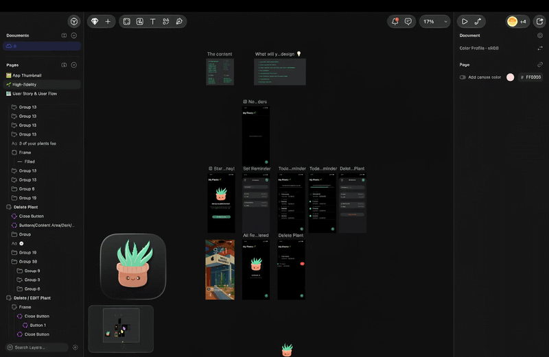

## 🌱 Planto App Demo

# 🌱 Planto

Planto is an iOS plant care application built with SwiftUI using the MVVM architecture

## Features
- Add and manage plants
- Set watering reminders
- Receive local notifications
- Track watering progress
- Edit and delete plant reminders
- Simple dark-themed interface

## Technologies
- Swift
- SwiftUI
- MVVM Architecture
- UserNotifications

## How to Run
1. Clone the repository.
2. Open the project in Xcode.
3. Select an iPhone simulator or device.
4. Build and run the application.

